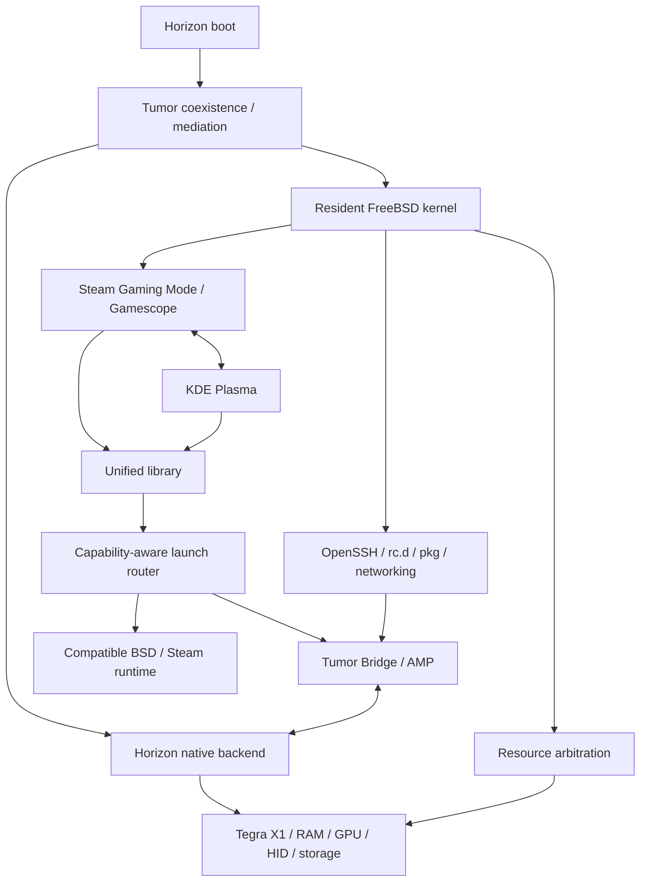

# EXODUS x1

**Nintendo Switch как полноценная портативная игровая система.**

Экспериментальная двухъядерная архитектура ОС: Horizon + FreeBSD.

На основе **4IFIR 2.7 от [Cooler3D](https://t.me/Cooler3D)**

[English](docs_en/README_ENG.MD) · [Архитектура](#архитектура-tumor) · [Статус](#статус-разработки) · [Документация](#документация) · [Благодарности](#благодарности)

> [!IMPORTANT]
> Проект находится в активной разработке (feature freeze: интеграция, исправления и приёмка). Это не готовая прошивка. Результаты CI, QEMU и референсной FreeBSD не доказывают работу на физической Nintendo Switch. Не устанавливайте экспериментальные сборки как повседневную систему.

## Концепция

EXODUS превращает оригинальную Nintendo Switch в универсальную игровую платформу. Вместо отказа от Horizon OS проект сохраняет её нативный бэкенд и наращивает вокруг него самостоятельную операционную среду.

- **Gaming Mode:** настоящий Steam и Gamescope как целевой основной интерфейс, а не имитация Big Picture.
- **Desktop Mode:** KDE Plasma, полноценный рабочий стол, переключение без перезагрузки как цель.
- **Единая библиотека:** установленные игры Switch, homebrew, Steam и совместимые PC-приложения с отдельными провайдерами исполнения.
- **Управление:** нативный FreeBSD OpenSSH, службы, сеть, pkg/Ports; SSH должен оставаться доступным во время нативной игры.
- **Эффективность:** общие ресурсы без лишних копий, сжатие страниц, дедупликация и измеряемые профили нагрузки.

## Архитектура Tumor

Horizon загружается первым. Цель Tumor (Опухоль) — сохранить минимально необходимый Horizon для нативных приложений и аппаратных сервисов, а управление и пользовательскую среду передать настоящему резидентному ядру FreeBSD. Это не dual boot и не BSD-совместимый слой homebrew.

*Схема показывает целевую архитектуру, а не подтверждённое физическое развёртывание.*

| Подсистема | Назначение |
| --- | --- |
| Horizon | Нативные приложения, собственный жизненный цикл процессов, драйверы и разрешённые аппаратные сервисы. |
| FreeBSD | Управляющее ядро и userspace, службы, сеть, SSH, пакетный менеджер. |
| Tumor Bridge / AMP | Версионированный межъядерный обмен, реестр возможностей, изоляция и явная передача ресурсов. |
| ADSP / EL2 | Исследование размещения управляющего ядра на сопроцессоре, ARM32/ARM64 транспорта и исполнения на Cortex-A57; доступ к EL2 и физическая загрузка ещё требуют доказательств. |
| Графика и ввод | Разграничение GPU, дисплея, HID, памяти и IRQ; освобождение ресурсов интерфейса при запуске игры. |
| MultiDriver | Целевая совместимость аппаратных сервисов с явным владением устройствами; не готовый универсальный драйвер. |

Канонические решения: [#103 — архитектура](https://github.com/Garyu-tt/EXODUSx1/issues/103) · [#105 — порт компонентов SteamOS на FreeBSD](https://github.com/Garyu-tt/EXODUSx1/issues/105) · [#349 — граф аппаратной приёмки](https://github.com/Garyu-tt/EXODUSx1/pull/349).

## Статус разработки

Срез на **26 ноября 2026 года**. Различаем интегрированный код, экспериментальные ветки и аппаратную приёмку.

| Направление | Состояние / доказательства |
| --- | --- |
| Kernel Bridge R01–R07 | Интегрирован host-reference стек: проверка допуска, интерфейс провайдеров, жизненный цикл процессов, supervisor, shell и compositor ([#340](https://github.com/Garyu-tt/EXODUSx1/pull/340)). |
| FreeBSD / Tumor | Референсные загрузка, SSH, D-Bus и службы; дальнейшая интеграция графики и менеджера ([#105](https://github.com/Garyu-tt/EXODUSx1/issues/105)). |
| AMP / ADSP | Исследовательские PR: межархитектурный транспорт, протокол запросов, совместимость сервисов и граф загрузки ([#349](https://github.com/Garyu-tt/EXODUSx1/pull/349), [#350](https://github.com/Garyu-tt/EXODUSx1/pull/350), [#351](https://github.com/Garyu-tt/EXODUSx1/pull/351)). |
| EL2 / Cortex-A57 | Экспериментальные QEMU-фикстуры: исключения, stage-2 MMU, контексты EL1, NEON, таймеры и SMP ([#352](https://github.com/Garyu-tt/EXODUSx1/pull/352)–[#361](https://github.com/Garyu-tt/EXODUSx1/pull/361)); статус каждого PR проверяется отдельно. |
| Steam / KDE / PC-игры | Порт upstream-компонентов и исследования ABI/CPU/GPU; полноценный Steam, KDE и Proton на физической Switch пока не подтверждены. |
| Библиотека | Офлайн-импорт Steam, homebrew и CorkDeck, маршрутизация нативного запуска; наличие в каталоге не означает совместимость. |
| Память и хранилище | Экспериментальные lossless-кодеки, integrity checks, дедупликация и EVCS; прирост FPS и объём доступной памяти на консоли не измерены. |
| Физическая Switch | Главный P0-барьер: одновременная работа обоих ядер, SSH во время игры, передача GPU/HID, сохранения и восстановление. |

[Issues](https://github.com/Garyu-tt/EXODUSx1/issues) · [Pull requests](https://github.com/Garyu-tt/EXODUSx1/pulls) · [CI / Actions](https://github.com/Garyu-tt/EXODUSx1/actions) · [История main](https://github.com/Garyu-tt/EXODUSx1/commits/main/)

## Память и единая библиотека

[EX-005](exodus/memory/README.md) исследует сжатие доступных CPU страниц размером 4 КиБ с возвратом к исходному формату для несжимаемых данных. Примеры полезной нагрузки: 8 байт для нулевой страницы, 41 байт для однородной RGBA8 и 9 или 17 байт для подходящих повторяющихся текселей. Это частные примеры без служебных метаданных, а не обещание увеличения RAM/VRAM.

[EVCS (#133)](https://github.com/Garyu-tt/EXODUSx1/issues/133) нацелен на одну физическую копию контента там, где это допускает бэкенд, автоматическое обнаружение игр и проверяемую маршрутизацию запуска. Прямой запуск архивов NSP/XCI не считается реализованным без подтверждённого разрешённого нативного пути.

## Безопасность

[Nintendo Safe Mode](docs/NINTENDO_SAFE_MODE.md) исключает интеграцию Nintendo eShop, Nintendo Account и Nintendo Switch Online. Неизвестные и рискованные возможности запрещаются по умолчанию. Это снижение риска, а не гарантия отсутствия бана. Используйте только законно полученный контент; сохраняйте резервные копии и проверяемый путь восстановления.

## Документация

- [Каталог и инструменты EXODUS](exodus/README.md)
- [Подсистема памяти и воспроизводимые тесты](exodus/memory/README.md)
- [Архитектура Tumor](https://github.com/Garyu-tt/EXODUSx1/issues/103) · [SteamOS / FreeBSD](https://github.com/Garyu-tt/EXODUSx1/issues/105) · [EVCS](https://github.com/Garyu-tt/EXODUSx1/issues/133)
- [Пакетный менеджмент](https://github.com/Garyu-tt/EXODUSx1/issues/87) · [Политика безопасности](docs/NINTENDO_SAFE_MODE.md)

Оригинальная документация 4IFIR (историческая)

Эти материалы относятся к исходному 4IFIR, а не к установке EXODUS и не подтверждают её совместимость.

[Оригинальный русский README](https://github.com/Garyu-tt/EXODUSx1/blob/22c97ba2de582cbd266b960cd207c8e7be3e0912/README.md) · [Оригинальный английский README](https://github.com/Garyu-tt/EXODUSx1/blob/a000dba9cd71da1568134f6308bb67bc439f8506/docs_en/README_ENG.MD)

[Latitude UI](docs/LATITUDE_UI.md) · [4IFIR installation / Установка](docs/INSTAL_4IFIR.md) · [Updates / Обновления](docs/OTHER_INSTRUCTION.md) · [Overclocking / Разгон](docs/OVERCLOKING.md) · [Suitable frequencies / Частоты](docs/SUITABLE_FREQUENCIES.md) · [4IFIR Wizard](docs/4IFIR_WIZARD.md) · [Wizard guide](docs/WIZARD_GUIDE.md) · [Basic setup / Базовая настройка](docs/BASE_WIZARD_GUIDE.md) · [Undervolt](docs/WIZARD_GUIDE_UV.md) · [RAM](docs/WIZARD_GUIDE_RAM.md) · [EMC Magician](docs/EMC_MAGICIAN.md) · [Modules / Модули](docs/MODULES_4IFIR.md) · [Composition / Состав](docs/COMPOSITION_4IFIR.md) · [Graphics patches / Графические патчи](docs/CHEATS_AND_PATCHES.md) · [Troubleshooting / Решение проблем](docs/PROBLEM.md)

[Telegram 4IFIR](https://t.me/kf4fr/48074) · [Обновления 4IFIR](https://t.me/kf4fr/98339) · [4IFIR checker](https://github.com/rashevskyv/4ifir-checker/releases)

## Благодарности

**[Cooler3D](https://t.me/Cooler3D)** — оригинальный создатель 4IFIR, фундаментального проекта, на основе которого вырос EXODUS. Отдельная благодарность Cooler3D и всему сообществу 4IFIR.

Разработка EXODUS: [Garyu-tt](https://github.com/Garyu-tt) и контрибьюторы.

Спасибо сообществам Atmosphère, Hekate, libnx, RetroNX, Ultrahand, FreeBSD, KDE, Gamescope и другим разработчикам открытого ПО. [Лицензии и исходные благодарности](docs/LICENSES.md). Компоненты сохраняют свои лицензии и уведомления об авторстве.

EXODUS — независимый проект, не официальный продукт Nintendo, Valve или FreeBSD.
