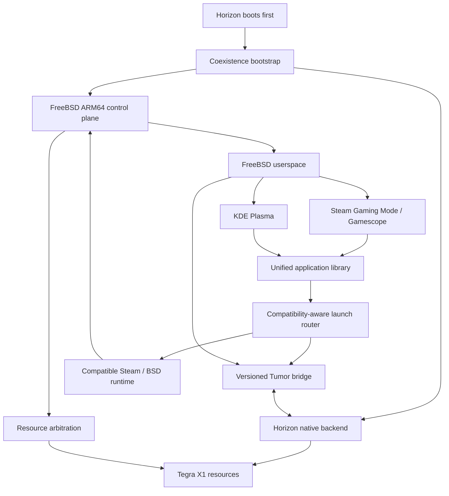

# EXODUS x1

**An experimental dual-kernel gaming platform for the first-generation Nintendo Switch.**

Built upon **4IFIR 2.7 by [Cooler3D](https://t.me/Cooler3D)** and the work of the Nintendo Switch homebrew community.

[Architecture](#architecture) · [Development status](#development-status) · [Documentation](#documentation) · [Благодарности / Credits](#credits) · [Русский](#о-проекте)

> [!IMPORTANT]
> EXODUS is under active development. It is not a production-ready firmware or a verified replacement for Horizon OS. Host tests and reference ARM64 builds do not establish physical Switch compatibility. Do not install experimental artifacts as a daily-driver firmware.

## What is EXODUS?

EXODUS aims to turn the original Nintendo Switch into a general-purpose handheld gaming platform while preserving Horizon as the native execution backend for Nintendo Switch applications. Rather than replacing everything that already works, it builds a new operating environment around the original system.

The goal is a single gaming library, a real FreeBSD environment, Steam Gaming Mode, and an alternative KDE Plasma desktop, with explicit runtime compatibility checks.

## Architecture

The project calls this architectural approach **Tumor**: grow an independent system around an existing one and retain the original as a provider of native capabilities.

This diagram describes the **target architecture**, not a claim that both kernels are already running together on physical hardware.

- **Horizon:** native application execution and authorized hardware capabilities.
- **FreeBSD:** resident ARM64 control plane; native userspace, networking, OpenSSH, services, and pkg/Ports.
- **Tumor bridge:** versioned inter-kernel communication, capability registry, and explicit ownership of shared memory and hardware.
- **Gaming Mode:** upstream Steam components and Gamescope are the target; KDE Plasma is the alternative desktop. Existing HOME/CorkDeck frontends are development and fallback paths.
- **Application providers:** separate native Horizon/homebrew, BSD and compatible Steam/Windows runtime routes. Catalog presence is not evidence that an application can execute.

Canonical decisions: [dual-kernel architecture #103](https://github.com/Garyu-tt/EXODUSx1/issues/103) and [SteamOS-on-FreeBSD track #105](https://github.com/Garyu-tt/EXODUSx1/issues/105).

## Development status

| Area | Current scope |
| --- | --- |
| Unified game library | Local Steam and Switch homebrew catalog tooling, native launch routing and runtime admission work. |
| FreeBSD / Tumor | ARM64 reference environment and integration work; resident dual-kernel coexistence on Switch remains a hardware acceptance gate. |
| Steam / KDE | Upstream port and integration targets; full Steam Gaming Mode and KDE operation on Switch are not established. |
| Windows applications | CorkDeck runtime handoff and executable validation work; PC game compatibility is title- and runtime-dependent. |
| Memory and storage | Experimental lossless page codecs, packed cold-page storage, integrity checks and deduplication. |
| Packages and remote access | FreeBSD pkg/Ports and native OpenSSH are the architectural targets; xpkg is scoped to EXODUS-specific content. |
| USB / MTP | Host diagnostic and lifecycle evidence tooling; device-side acceptance is separate. |
| Nintendo Safe Mode | Mandatory fail-closed policy specification and release acceptance requirement. |

For the live development record, see [issues](https://github.com/Garyu-tt/EXODUSx1/issues), [pull requests](https://github.com/Garyu-tt/EXODUSx1/pulls), and [commit history](https://github.com/Garyu-tt/EXODUSx1/commits/main/).

### Memory and storage research

The [EX-005 memory subsystem](exodus/memory/README.md) implements lossless compression for CPU-readable 4 KiB pages, with raw fallback for data that does not compress. Documented example payloads include 8 bytes for an all-zero page, 41 bytes for a solid RGBA8 staging page, and 9 or 17 bytes for suitable repeated wide texels. These are pattern-specific results, excluding additional storage metadata; they are not general RAM/VRAM expansion ratios or game performance benchmarks.

The project also investigates a [single-copy content model (EVCS)](https://github.com/Garyu-tt/EXODUSx1/issues/133) to avoid unnecessary duplication of locally owned content.

### Safety and compatibility

EXODUS targets offline and ordinary internet/LAN use without integrating Nintendo eShop, Nintendo Account, Nintendo Switch Online, or other prohibited official-service requests. Unknown or high-risk capabilities are denied by default under the [Nintendo Safe Mode specification](docs/NINTENDO_SAFE_MODE.md). This is risk avoidance, not enforcement evasion, and is not a guarantee against bans.

Use only software and content you are legally entitled to use. Back up your data before experimenting. There is no claim of compatibility with every Switch hardware revision, Horizon version, or PC game.

## Documentation

### EXODUS

- [Application catalog and host tooling](exodus/README.md)
- [Memory compression and reproducible probes](exodus/memory/README.md)
- [Nintendo Safe Mode specification](docs/NINTENDO_SAFE_MODE.md)
- [Dual-kernel architecture](https://github.com/Garyu-tt/EXODUSx1/issues/103)
- [SteamOS-on-FreeBSD port](https://github.com/Garyu-tt/EXODUSx1/issues/105)
- [Package management](https://github.com/Garyu-tt/EXODUSx1/issues/87)

### Original 4IFIR documentation (upstream / historical)

These guides describe the inherited 4IFIR environment, not the EXODUS installation process or its compatibility guarantees.

- [Original README (archived in Git history)](https://github.com/Garyu-tt/EXODUSx1/blob/22c97ba2de582cbd266b960cd207c8e7be3e0912/README.md)
- [English guide](docs_en/README_ENG.MD)
- [Latitude UI](docs/LATITUDE_UI.md)
- [4IFIR installation](docs/INSTAL_4IFIR.md) · [Updates](docs/OTHER_INSTRUCTION.md)
- [Overclocking](docs/OVERCLOKING.md) · [Suitable frequencies](docs/SUITABLE_FREQUENCIES.md)
- [4IFIR Wizard](docs/4IFIR_WIZARD.md) · [Wizard guide](docs/WIZARD_GUIDE.md) · [Basic setup](docs/BASE_WIZARD_GUIDE.md) · [Undervolt](docs/WIZARD_GUIDE_UV.md) · [RAM](docs/WIZARD_GUIDE_RAM.md)
- [EMC Magician](docs/EMC_MAGICIAN.md) · [Modules](docs/MODULES_4IFIR.md) · [Composition](docs/COMPOSITION_4IFIR.md)
- [Graphics modifications](docs/CHEATS_AND_PATCHES.md) · [Troubleshooting](docs/PROBLEM.md)
- Original 4IFIR community: [Telegram group](https://t.me/kf4fr/48074) · [Upstream updates](https://t.me/kf4fr/98339) · [4IFIR checker releases](https://github.com/rashevskyv/4ifir-checker/releases)

## Credits

**[Cooler3D](https://t.me/Cooler3D)**: original creator of 4IFIR, the foundation from which EXODUS grew. Special thanks to Cooler3D and everyone who contributed to the original project.

EXODUS development: [Garyu-tt](https://github.com/Garyu-tt) and contributors.

Thanks also to the Atmosphère, Hekate, libnx, RetroNX, Ultrahand, FreeBSD, KDE, Gamescope, and wider open-source communities. Original credits and component license information remain in [Licenses and acknowledgments](docs/LICENSES.md). Individual components retain their applicable licenses and notices.

EXODUS is an independent community project, not an official Nintendo, Valve or FreeBSD product.

## О проекте

**EXODUS x1** — экспериментальная игровая платформа для Nintendo Switch первого поколения, выросшая из **4IFIR 2.7 от [Cooler3D](https://t.me/Cooler3D)**.

Целевая архитектура: Horizon загружается первым и сохраняется как нативный бэкенд, FreeBSD ARM64 становится управляющей средой, а Steam Gaming Mode и KDE Plasma предоставляют единый интерфейс к библиотеке приложений. Связь между ядрами осуществляется через Tumor Bridge с явным разграничением ресурсов и полномочий.

Проект исследует совместимые среды исполнения, экономию памяти, дедупликацию и хранение игр без лишних копий. Полноценная работа двух ядер, Steam и компьютерных игр на реальной консоли пока не подтверждена. Текущий статус и критерии приёмки публикуются в задачах репозитория.

Отдельная благодарность Cooler3D и всему сообществу 4IFIR. Без вашей работы этого проекта не было бы.
