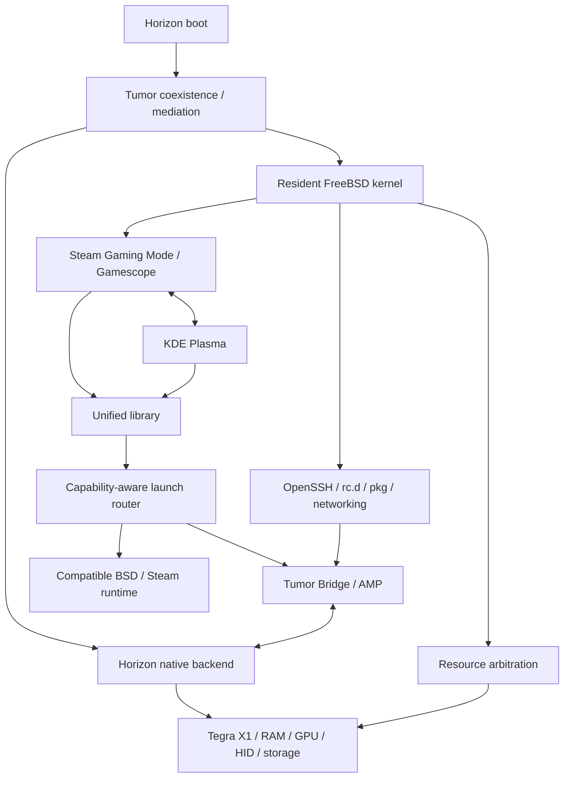

# EXODUS x1

**The Nintendo Switch as a full-featured handheld gaming platform.**

An experimental dual-kernel OS architecture: Horizon + FreeBSD.

Built upon **4IFIR 2.7 by [Cooler3D](https://t.me/Cooler3D)**

[Русский](../README.md) · [Architecture](#tumor-architecture) · [Status](#development-status) · [Documentation](#documentation) · [Credits](#credits)

> [!IMPORTANT]
> Active development (feature freeze: integration, fixes and acceptance). This is not production-ready firmware. CI, QEMU and reference FreeBSD results do not prove operation on physical Nintendo Switch hardware. Do not install experimental builds as daily-driver firmware.

## Vision

EXODUS aims to turn the original Nintendo Switch into a general-purpose handheld gaming platform. Instead of discarding Horizon OS, it preserves its native backend and grows an independent operating environment around it.

- **Gaming Mode:** actual Steam and Gamescope as the target default interface, not a Big Picture imitation.
- **Desktop Mode:** KDE Plasma, a full desktop, with reboot-free switching as the goal.
- **Unified library:** installed Switch games, homebrew, Steam and compatible PC applications with separate execution providers.
- **Administration:** native FreeBSD OpenSSH, services, networking and pkg/Ports; SSH should remain available during a native game.
- **Efficiency:** shared resources without unnecessary copies, page compression, deduplication and measured workload profiles.

## Tumor architecture

Horizon boots first. Tumor aims to retain the minimum Horizon environment required for native applications and hardware services, while a genuine resident FreeBSD kernel provides administration and userspace. This is neither dual boot nor a homebrew BSD compatibility shim.

*The diagram describes the target architecture, not a verified physical deployment.*

| Subsystem | Purpose |
| --- | --- |
| Horizon | Native applications, its own process lifecycle, drivers and authorized hardware services. |
| FreeBSD | Control kernel and userspace, services, networking, SSH and package management. |
| Tumor Bridge / AMP | Versioned inter-kernel communication, capability registry, isolation and explicit resource handoff. |
| ADSP / EL2 | Research into coprocessor placement of the control kernel, ARM32/ARM64 transport and Cortex-A57 execution; physical boot and EL2 access remain unproven. |
| Graphics and input | Explicit GPU, display, HID, memory and IRQ ownership; release UI resources when launching a game. |
| MultiDriver | Target hardware-service compatibility with explicit device ownership, not a finished universal driver. |

Canonical decisions: [#103 — architecture](https://github.com/Garyu-tt/EXODUSx1/issues/103) · [#105 — SteamOS components on FreeBSD](https://github.com/Garyu-tt/EXODUSx1/issues/105) · [#349 — hardware admission graph](https://github.com/Garyu-tt/EXODUSx1/pull/349).

## Development status

Snapshot: **26 November 2026**. Integrated code, experimental branches and hardware acceptance are distinct.

| Track | Status / evidence |
| --- | --- |
| Kernel Bridge R01–R07 | Integrated host-reference stack: admission, provider interfaces, process lifecycle, supervisor, shell and compositor ([#340](https://github.com/Garyu-tt/EXODUSx1/pull/340)). |
| FreeBSD / Tumor | Reference boot, SSH, D-Bus and services; further graphics and manager integration ([#105](https://github.com/Garyu-tt/EXODUSx1/issues/105)). |
| AMP / ADSP | Research PRs: cross-ISA transport, request protocol, service compatibility and boot graph ([#349](https://github.com/Garyu-tt/EXODUSx1/pull/349), [#350](https://github.com/Garyu-tt/EXODUSx1/pull/350), [#351](https://github.com/Garyu-tt/EXODUSx1/pull/351)). |
| EL2 / Cortex-A57 | Experimental QEMU fixtures: exceptions, stage-2 MMU, EL1 contexts, NEON, timers and SMP ([#352](https://github.com/Garyu-tt/EXODUSx1/pull/352)–[#361](https://github.com/Garyu-tt/EXODUSx1/pull/361)); check each PR separately for acceptance. |
| Steam / KDE / PC games | Upstream port and ABI/CPU/GPU research; full Steam, KDE and Proton on physical Switch remain unverified. |
| Library | Offline Steam, homebrew and CorkDeck imports and native launch routing; catalog presence does not establish compatibility. |
| Memory and storage | Experimental lossless codecs, integrity checks, deduplication and EVCS; no measured console FPS or usable memory improvement. |
| Physical Switch | Main P0 gate: simultaneous kernel liveness, SSH during gameplay, GPU/HID handoff, save integrity and recovery. |

[Issues](https://github.com/Garyu-tt/EXODUSx1/issues) · [Pull requests](https://github.com/Garyu-tt/EXODUSx1/pulls) · [CI / Actions](https://github.com/Garyu-tt/EXODUSx1/actions) · [Main history](https://github.com/Garyu-tt/EXODUSx1/commits/main/)

## Memory and unified library

[EX-005](../exodus/memory/README.md) investigates compression of CPU-readable 4 KiB pages with raw fallback for incompressible data. Example payloads: 8 bytes for a zero page, 41 bytes for a solid RGBA8 page and 9 or 17 bytes for suitable repeated texels. These are pattern-specific examples excluding metadata, not promises of RAM/VRAM expansion.

[EVCS (#133)](https://github.com/Garyu-tt/EXODUSx1/issues/133) targets one physical copy of content wherever backend semantics permit, automatic game discovery and verified launch routing. Direct NSP/XCI archive execution is not considered implemented without a verified authorized native route.

## Safety

[Nintendo Safe Mode](../docs/NINTENDO_SAFE_MODE.md) excludes Nintendo eShop, Nintendo Account and Nintendo Switch Online integration. Unknown or high-risk capabilities are denied by default. This is risk reduction, not a guarantee against bans. Use legally obtained content only; maintain backups and a verified recovery path.

## Documentation

- [EXODUS catalog and tooling](../exodus/README.md)
- [Memory subsystem and reproducible tests](../exodus/memory/README.md)
- [Tumor architecture](https://github.com/Garyu-tt/EXODUSx1/issues/103) · [SteamOS / FreeBSD](https://github.com/Garyu-tt/EXODUSx1/issues/105) · [EVCS](https://github.com/Garyu-tt/EXODUSx1/issues/133)
- [Package management](https://github.com/Garyu-tt/EXODUSx1/issues/87) · [Safety policy](../docs/NINTENDO_SAFE_MODE.md)

Original 4IFIR documentation (historical)

These resources describe upstream 4IFIR, not EXODUS installation or its compatibility.

[Original Russian README](https://github.com/Garyu-tt/EXODUSx1/blob/22c97ba2de582cbd266b960cd207c8e7be3e0912/README.md) · [Original English README](https://github.com/Garyu-tt/EXODUSx1/blob/a000dba9cd71da1568134f6308bb67bc439f8506/docs_en/README_ENG.MD)

[Latitude UI](../docs/LATITUDE_UI.md) · [4IFIR installation / Установка](../docs/INSTAL_4IFIR.md) · [Updates / Обновления](../docs/OTHER_INSTRUCTION.md) · [Overclocking / Разгон](../docs/OVERCLOKING.md) · [Suitable frequencies / Частоты](../docs/SUITABLE_FREQUENCIES.md) · [4IFIR Wizard](../docs/4IFIR_WIZARD.md) · [Wizard guide](../docs/WIZARD_GUIDE.md) · [Basic setup / Базовая настройка](../docs/BASE_WIZARD_GUIDE.md) · [Undervolt](../docs/WIZARD_GUIDE_UV.md) · [RAM](../docs/WIZARD_GUIDE_RAM.md) · [EMC Magician](../docs/EMC_MAGICIAN.md) · [Modules / Модули](../docs/MODULES_4IFIR.md) · [Composition / Состав](../docs/COMPOSITION_4IFIR.md) · [Graphics patches / Графические патчи](../docs/CHEATS_AND_PATCHES.md) · [Troubleshooting / Решение проблем](../docs/PROBLEM.md)

[4IFIR Telegram](https://t.me/kf4fr/48074) · [4IFIR updates](https://t.me/kf4fr/98339) · [4IFIR checker](https://github.com/rashevskyv/4ifir-checker/releases)

## Credits

**[Cooler3D](https://t.me/Cooler3D)** is the original creator of 4IFIR, the foundational project from which EXODUS grew. Special thanks to Cooler3D and the entire 4IFIR community.

EXODUS development: [Garyu-tt](https://github.com/Garyu-tt) and contributors.

Thanks to the Atmosphère, Hekate, libnx, RetroNX, Ultrahand, FreeBSD, KDE, Gamescope and wider open-source communities. [Licenses and original acknowledgments](../docs/LICENSES.md). Components retain their applicable licenses and attribution notices.

EXODUS is an independent project, not an official Nintendo, Valve or FreeBSD product.
